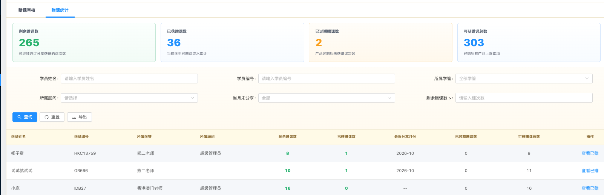
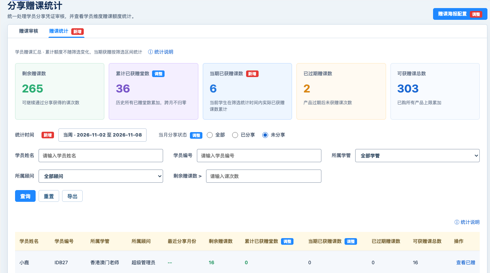

# 分享赠堂（后台优化）

PRD · V2.3 · 更新日期 2026-11-06

运营后台用于查看分享赠课统计，并维护赠课海报、赠堂数量、图片和显示状态。统计结果按实际赠课到账记录计算，海报配置保存后供新的读取请求使用，历史记录保留创建时的配置快照。

## 一、涉及端口 · 菜单 · 功能点

1. **运营后台｜学员管理 → 分享赠课 → 赠课统计**：按日期、学员和分享状态查询赠课数据，查看累计与当期统计、学员明细及已赠课记录。
2. **运营后台｜学员管理 → 分享赠课 → 赠课海报配置**：新增、编辑、显示／隐藏、删除和排序海报，配置每张海报的赠堂数量及相关内容。

## 二、业务规则

### 2.1 赠课统计

- 日期区间默认当周，提供“当周”快捷恢复；开始日期不得晚于结束日期。页面统计时区采用 Asia/Shanghai，周一至周日为一周，海外业务口径待确认。
- 支持按学员姓名／编号、所属学管、所属顾问、剩余赠课数和“当月分享状态”筛选；“当月分享状态”仅判断自然月内是否成功调起分享，不随日期区间改成“当期分享状态”。
- 当周已分享用户按成功调起分享的学员去重；仅切换海报、保存图片或复制文案不计入分享统计。查询失败显示明确错误，不用0代替失败。
- 列表展示学员姓名、学员编号、学管、顾问、最近分享月份、剩余赠课数、累计已获赠堂数、当期已获赠课数、已过期赠课数、可获赠课总数，并提供查看已赠课明细的操作。
- **剩余赠课数**为学员当前仍可获赠的课次数，公式为：可获赠课总数 − 累计已获赠堂数 − 已过期赠课数。
- **累计已获赠堂数**为学员历次实际到账赠堂数之和，跨月累计，包含当期已获赠数量，不随日期筛选变化。
- **当期已获赠课数**表示当前学生在筛选统计时间内实际已获赠课数累计，按实际赠课日期统计，包含开始日和结束日；随日期及学员筛选联动，不等于分享次数。
- **最近分享月份**为学员最近一次分享所在的年月；未分析的学员不进入该列表。
- **已过期赠课数**为学员已购产品到期时尚未领取、已失效的赠课额度之和，不计入累计已获赠堂数。
- **可获赠课总数**为学员各已购产品的赠课上限之和，额度关系为：可获赠课总数 = 剩余赠课数 + 累计已获赠堂数 + 已过期赠课数。
- 零结果正常显示0；有效0与查询失败分别处理，不能以0掩盖请求失败。

### 2.2 赠课海报配置

- 每张海报独立维护标题、图片、赠堂数、备注、显示状态、创建人和创建时间；列表按序号展示并支持同状态内拖拽排序。
- 赠堂数为大于0的整数，单位为“节”；空值、0、负数和小数不可保存。默认值为1节，列表展示当前配置值。
- 标题必填，最多30字；分享文案最多300字；备注用于记录活动或投放说明。新增时图片必填，编辑时未重新上传则保留原图。
- 支持新增、编辑、显示／隐藏和删除；最多维护20张海报，同时最多显示10张，至少保留1张显示状态的海报。删除或隐藏不删除已生成的历史分享、赠课记录及配置快照。
- 图片支持 JPEG、JPG、PNG；大于1MB自动压缩至1MB以内，不超过1MB保留原图。压缩保持原比例，不裁剪、不拉伸；处理完成展示预览、实际尺寸和文件大小，处理失败提示重新上传，处理期间禁止保存。
- 保存成功后，新的读取请求使用最新海报配置；已打开页面不承诺自动刷新。编辑海报不回算已生成的赠课记录，历史记录继续使用创建时的图片、文案和赠堂数量快照。
- 历史海报缺少赠堂数配置时按1节兼容；已有配置不因后续编辑降为1节。

### 2.3 赠堂数量与统计关联

- 新生成的赠课记录使用分享发生时经服务端确认的海报配置版本及赠堂数量；统计按实际到账数量计入当期和累计指标。
- 同一已购产品的剩余赠课数不足配置数量时，不拆分产品、不降为1节，记录为“不可赠”并展示“剩余赠课数不足”。
- 创建订单、付款确认和课时入账全部成功后，状态为“已赠课”，实际到账数量进入统计；任一步失败保留“待赠课”，支持查看原因并重试，重试不得重复赠堂。

## 三、业务示例

1. 学员历史累计已获赠12节，本周实际到账2节：累计显示12，当期显示2；切换日期区间后累计仍为12，当期按新范围重算。
2. 海报A配置3节、海报B配置18节，保存后列表分别显示3节和18节；输入0或1.5时阻止保存，原配置不变。
3. 当前海报配置为2节，但匹配产品剩余赠课数只有1节：该记录显示“不可赠／剩余赠课数不足”，不拆分、不降额。
4. 第一条海报配置的“编辑”按钮显示「需求」标识，其余海报的编辑按钮不重复显示；海报排序变化后，标识跟随当前列表第一条。

## 四、截图对照与模拟数据汇总

### 4.1 页面截图对照

以下截图用于对照页面结构、字段顺序和汇总卡片展示。参考截图中的汇总关系为：可获赠课总数 303 = 剩余赠课数 265 + 已获赠课数 36 + 已过期赠课数 2。

### 4.2 模拟数据汇总结果

| 对比项 | 截图参考值 | 当前模拟数据 | 计算规则 |
| --- | ---: | ---: | --- |
| 剩余赠课数 | 265 | 265 | 可获赠课总数 − 累计已获赠堂数 − 已过期赠课数 |
| 累计已获赠堂数 | 36 | 36 | 所有学员赠课流水累计 |
| 已过期赠课数 | 2 | 2 | 所有学员已过期额度累计 |
| 可获赠课总数 | 303 | 303 | 剩余赠课数 + 累计已获赠堂数 + 已过期赠课数 |
| 当期已获赠课数 | 截图未展示 | 按筛选日期和赠课流水动态计算 | 仅统计所选日期内实际到账数量 |

当前模拟数据保留截图中的前三条学员及额度口径；新增的“当期已获赠课数”字段不写死，按每条学员的赠课日期流水，在日期、学员和分享状态筛选后重新计算。

## 五、功能需求与验收

| 编号／事项 | 需求摘要或规则链接 | 操作与可观察结果 | 状态 |
| --- | --- | --- | --- |
| FR01 赠课统计筛选 | 2.1 | 打开统计页默认显示当周；输入日期、学员或分享状态后查询，列表与统计卡片按同一筛选范围更新；开始日期晚于结束日期时阻止查询并提示。 | 待验收 |
| FR02 累计与当期口径 | 2.1 | 切换日期区间，累计已获赠堂数保持历史累计，当期已获赠课数按成功到账时间重新计算；零结果显示0，查询失败显示错误。 | 待验收 |
| FR03 海报配置列表 | 2.2 | 打开赠课海报配置，可见序号、标题、海报图、赠堂数、状态、创建信息及操作；只在当前第一条编辑按钮旁显示一个「需求」标识。 | 待验收 |
| FR04 海报新增与编辑 | 2.2 | 输入合法标题、图片和正整数赠堂数后保存，列表显示新值；空值、0、负数、小数或缺少新增图片时阻止保存，失败保留输入。 | 待验收 |
| FR05 海报状态与排序 | 2.2 | 显示／隐藏、删除和同状态内拖拽排序可用；最多20张、最多10张显示且至少保留1张显示，历史记录不受删除或隐藏影响。 | 待验收 |
| FR06 图片处理与配置生效 | 2.2 | 上传超过1MB图片时压缩至1MB以内并展示预览、尺寸和文件大小；处理期间不可保存，失败可重试；保存后新读取请求使用新配置。 | 待验收 |
| FR07 数量与历史快照 | 2.3 | 新记录使用服务端确认的配置版本及赠堂数量；编辑海报后既有记录数量不变；缺少历史配置时按1节兼容。 | 待验收 |
| FR08 赠堂失败与统计入账 | 2.3 | 订单、付款和入账均成功后按实际数量计入统计；任一步失败保留待赠课并可重试，重试不重复赠堂。 | 待验收 |

## 六、待确认事项

| 编号 | 具体问题 | 影响及确认角色 |
| --- | --- | --- |
| D01 | 统计页既有“已获赠课数”卡片与新增“累计已获赠堂数”是否重复，是否保留两项 | 产品确认统计页指标层级及文案 |
| D02 | 配置赠堂数超过单个已购产品剩余赠课数时，是否保持“不拆分、不降额”的不可赠规则，以及符合条件产品的并列排序规则 | 产品、运营确认产品筛选及赠堂处理 |
| D03 | 海外业务是否统一采用 Asia/Shanghai 时区及周一至周日作为统计周 | 产品、运营确认日期筛选和周统计口径 |
